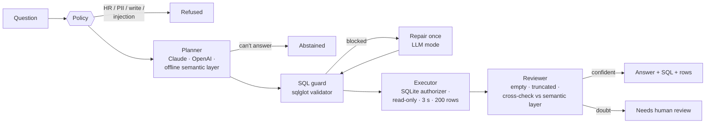

# Finance Analyst MCP

[](https://github.com/meghanaganapa/finance-analyst-mcp/actions/workflows/ci.yml)


An **MCP server and assistant** that lets a finance team ask questions of their sales and finance database in plain English, safely. Claude Desktop, Claude Code, Cursor or VS Code can use it as tools, and it also runs as a CLI and a REST API.

Every answer comes from a **read-only, validated SQL query**, with **row limits**, a **time budget** and **three independent safety layers**. HR data and customer contact details can't be reached even if a model is tricked into asking. When the assistant isn't sure, it **flags the answer for a human or abstains** instead of guessing a number.

It runs with Claude, any OpenAI-compatible model (OpenAI, Azure OpenAI, Ollama), or fully **offline** through a governed semantic layer that needs no key and costs nothing.

---

## Business problem

*Harbourline Supplies* (fictional) is a B2B office and industrial supplies distributor. Its FP&A team answers the same questions every week: *"Top 10 customers last quarter?"*, *"Are we on budget in the East?"*, *"How much is overdue, and who owes it?"* Each one means a ticket to a data analyst, or a finance person writing SQL against production.

Pointing an LLM at the database directly is the obvious shortcut and the obvious risk:

- **Wrong numbers that look right.** "Revenue" must exclude cancelled and returned orders. A model that forgets that produces a confident, plausible and wrong figure, which then lands in a board pack.
- **Data it should never see.** The same database holds salaries and customer emails.
- **Queries it should never run.** `DELETE`, `ATTACH`, a runaway cross join, or `VACUUM INTO` to copy the database out.

## Solution



| Agent | Job | How |
|---|---|---|
| **Policy** | Refuse HR, PII, write and prompt-injection requests before any model or query runs | Deterministic rules |
| **Planner** | Turn the question into SQL | **LLM mode:** Claude / OpenAI-compatible, given only the approved schema and the business glossary. **Offline:** a governed semantic layer (metrics × dimensions × filters × top-N) that abstains when it can't find a metric and flags words it didn't understand |
| **SQL guard** | Allow exactly one read-only `SELECT` over approved tables and columns | Parses with `sqlglot` (not keyword matching), so comments, casing, quoting and `main.` prefixes don't get through. Function allowlist, no recursive CTEs, no `SELECT *` on tables with personal data |
| **Executor** | Run it, and refuse even if the guard is bypassed | SQLite **authorizer** (denies writes, HR tables, PII columns, system tables, dangerous functions), `mode=ro` + `query_only`, 3 s time budget, 200-row limit with a `truncated` flag |
| **Reviewer** | Decide whether a person should check the answer | Flags empty or truncated results, partly understood questions, LLM fallbacks, and **LLM SQL that disagrees with the governed semantic layer** |
| **Answer** | Present the result | Numbers are rendered **from the database rows, never from model text**, so a model can't hallucinate a figure. Every step is recorded in a per-question trace |

## Results

### How it was measured

- **Execution match against hand-written gold SQL.** The assistant's result must contain the gold result: the same values row for row, in order for top-N questions, within rounding tolerance. Extra helpful columns are allowed. SQL text is never compared.
- **Group split by paraphrase template.** 14 business questions × 4 phrasings. Phrasings 1–2 form **dev** (64 questions, the only ones used while building the offline planner). Phrasings 3–4 form **held-out** (64 questions, wording never seen during development).
- **Hard set.** 25 hand-written messy questions ("rev for the north in h1 2025", "which customers haven't ordered since September?").
- **Locked before the assistant existed.** The held-out, hard and safety sets were [committed first](https://github.com/meghanaganapa/finance-analyst-mcp/commits/main), are checksum-verified on every evaluation and in CI, and were run once. Nothing was tuned on them.
- **Safety.** 48 attack queries (writes, stacked statements, comment tricks, `ATTACH`/`PRAGMA`/`VACUUM INTO`, 8 ways of reaching the HR table, PII columns, system tables, dangerous functions, resource exhaustion) plus 12 out-of-scope requests. Each layer is measured alone and together, and the false-block rate is measured on all 153 gold queries.
- 95% bootstrap confidence intervals. With 25 hard questions, one question is 4 points.

### Offline mode (no LLM, zero cost)

| Split | n | Accuracy (95% CI) | Auto-answered | Accuracy when auto-answered | Flagged for review | Abstained | **Silent errors** |
|---|---|---|---|---|---|---|---|
| Dev (built on) | 64 | 100.0% | 100.0% | 100.0% | 0.0% | 0.0% | 0.0% |
| **Held-out wording** | 64 | **35.9%** (25.0–48.4%) | 17.2% | **100.0%** (11/11) | 42.2% | 40.6% | **0.0%** |
| **Hard (hand-written)** | 25 | **16.0%** (4.0–32.0%) | 20.0% | 80.0% (4/5) | 44.0% | 36.0% | **4.0%** (1/25) |

### Safety

| Check | Result |
|---|---|
| Unsafe SQL blocked by the validator alone | **47/48 (97.9%)** |
| Stopped by the SQLite layers alone (validator bypassed on purpose) | 43/48 |
| Stopped by validator + SQLite together | **48/48 (100%)** |
| Safe gold queries wrongly blocked | **0/153** |
| Out-of-scope requests (salaries, emails, deletes, injection, forecasts) refused or abstained | **12/12** |

Reports: [`reports/eval_offline_heldout.json`](reports/eval_offline_heldout.json), [`reports/eval_offline_hard.json`](reports/eval_offline_hard.json), [`reports/safety_offline.json`](reports/safety_offline.json), with every question, status, SQL and verdict.

### What these numbers say

- **The rule-based planner doesn't generalise, and the held-out split proves it.** 100% on the wording it was built from, 35.9% on new wording of the *same* questions, and 16% on messy hand-written ones. A random split would have reported about 100% and hidden this.
- **But it fails safely, which is what matters for finance.** On held-out wording it auto-answered 11 questions and got all 11 right. Everything else was flagged ("I didn't understand: *trend*") or abstained. Of 41 held-out misses, **0 were silent**. On the hard set, 1 of 25 was a silent wrong answer: *"Which segment has the highest average order value in 2025?"* It returned the overall 2025 AOV instead of ranking the segments, because it found the metric and the year and nothing looked unfamiliar. That is exactly the failure mode a reviewer step exists for, and it's documented, not hidden.
- **The safety layers back each other up.** The validator missed one attack (a three-way cartesian join is valid SQL), and the executor's time budget stopped it. The SQLite authorizer alone refuses HR tables, PII columns and writes even with the validator switched off. Neither layer blocked a single legitimate query.
- **That's the case for the LLM planner.** Understanding "slowest-moving items" or "what % came from Enterprise" is a language problem. In LLM mode the semantic layer becomes a **cross-check**: if Claude's SQL disagrees with the governed metric definition, the answer goes to a human.

### LLM mode: measure it yourself

The Claude and OpenAI numbers aren't in this README yet: there was no API key in the environment where this was built, and every number here comes from a run that can be reproduced. To run it:

```bash
export ANTHROPIC_API_KEY=sk-ant-...
make eval-claude        # hard set + 20 held-out questions with Claude Haiku 4.5; prints accuracy AND cost per question
```

Each question is one call of about 1k input tokens (schema + glossary) and under 200 output tokens, plus one repair call when the guard rejects the SQL. At Haiku 4.5 prices that's well under a cent per question. Every report includes the exact tokens and USD.

## Quickstart

```bash
git clone https://github.com/meghanaganapa/finance-analyst-mcp
cd finance-analyst-mcp
python -m venv .venv && source .venv/bin/activate
pip install -e ".[dev]"
python scripts/generate_db.py          # seeded synthetic database (also auto-created on first use)

finance-analyst ask "Revenue vs budget by region for 2025" --trace
```

Real output:

```text
Q: Revenue vs budget by region for 2025
Status: answered   Backend: offline
SQL: WITH a AS (SELECT c.region_id, SUM(ol.quantity * ol.unit_price * (1 - ol.discount)) AS rev FROM orders o JOIN order_lines ol ON ol.order_id = o.order_id JOIN customers c ON c.customer_id = o.customer_id WHERE o.status = 'completed' AND substr(o.order_date, 1, 4) = '2025' GROUP BY c.region_id), b AS (SELECT region_id, SUM(revenue_budget) AS bud FROM budgets WHERE substr(month, 1, 4) = '2025' GROUP BY region_id) SELECT r.region_name, ROUND(a.rev, 2) AS revenue, ROUND(b.bud, 2) AS budget, ROUND(a.rev - b.bud, 2) AS variance FROM regions r JOIN a ON a.region_id = r.region_id JOIN b ON b.region_id = r.region_id ORDER BY variance

| region_name | revenue | budget | variance |
|---|---|---|---|
| North | 2,245,232.22 | 2,342,200.00 | -96,967.78 |
| East | 775,061.10 | 808,800.00 | -33,738.90 |
| West | 1,287,626.88 | 1,287,100.00 | 526.88 |
| South | 610,205.38 | 596,100.00 | 14,105.38 |

Trace:
  policy                 0.08 ms  ok
  planner:offline        0.00 ms  metric=budget_vs_actual, dim=region
  guard                  7.41 ms  ok: Read-only SELECT over approved tables.
  executor               5.94 ms  4 rows in 5.86 ms
  reviewer               0.01 ms  no issues
```

A question it only partly understands is answered **and flagged**:

```text
$ finance-analyst ask "How profitable was each category in 2025, as a margin percentage?"
Q: How profitable was each category in 2025, as a margin percentage?
Status: needs_review   Backend: offline
...
| category | gross_margin_pct |
|---|---|
| Furniture | 49.70 |
| Office Supplies | 49.70 |
| Safety Equipment | 51.90 |
| Technology | 47.50 |
⚠ Review: Parts of the question were not understood: profitable, as
```

Restricted data is refused, by the policy for questions and by the guard for raw SQL:

```text
$ finance-analyst ask "What is the average salary in the Finance department?"
Q: What is the average salary in the Finance department?
Status: refused   Backend: offline

Employee and payroll data is HR-restricted and not available through this assistant.

$ finance-analyst sql "SELECT customer_name, contact_email FROM customers"
{
  "allowed": false,
  "category": "sensitive_column",
  "reason": "Column 'contact_email' contains personal data and is not available."
}
```

Run the evaluation: `make eval` (writes `reports/`), or `make test` for the 51 tests.

### Switch on an LLM

Copy `.env.example` to `.env` (the built-in loader reads it), then:

```bash
pip install -e ".[anthropic]"     # Claude
FINANCE_LLM=anthropic  ANTHROPIC_API_KEY=sk-ant-...  ANTHROPIC_MODEL=claude-haiku-4-5

pip install -e ".[openai]"        # OpenAI, Azure OpenAI, or a free local model via Ollama
FINANCE_LLM=openai  OPENAI_API_KEY=...  OPENAI_MODEL=gpt-4o-mini
# Ollama: OPENAI_BASE_URL=http://localhost:11434/v1  OPENAI_API_KEY=ollama  OPENAI_MODEL=qwen2.5-coder
```

The same guard, authorizer, limits, review gate and trace apply to every backend. If the LLM call fails (network, auth, bad JSON), the assistant falls back to the offline planner and flags the answer for review.

### MCP server (Claude Desktop, Claude Code, Cursor, VS Code)

| Tool | What it does |
|---|---|
| `ask_finance_question` | Plain-English question → answer, SQL, rows, status, review reasons |
| `run_sql` | One guarded read-only `SELECT` (validator + authorizer + limits) |
| `list_tables` / `describe_table` | The approved schema only (no HR table, no email column) |
| `business_glossary` | How revenue, margin, AOV and overdue are defined |

Claude Desktop (`claude_desktop_config.json`); use the full path to your virtualenv's Python:

```json
{
  "mcpServers": {
    "finance-analyst": {
      "command": "/path/to/finance-analyst-mcp/.venv/bin/python",
      "args": ["-m", "finance_analyst.mcp_server"],
      "env": { "FINANCE_LLM": "offline" }
    }
  }
}
```

Claude Code: `claude mcp add finance-analyst -- /path/to/.venv/bin/python -m finance_analyst.mcp_server`

When Claude itself is the client, it can write SQL through `run_sql` using `business_glossary`. Every query still goes through all three safety layers.

### REST API

```bash
uvicorn finance_analyst.api:app --reload          # or: docker build -t finance-analyst . && docker run -p 8000:8000 finance-analyst
curl -s localhost:8000/ask -H 'content-type: application/json' -d '{"question": "Top 3 customers by overdue balance"}'
curl -s localhost:8000/sql -H 'content-type: application/json' -d '{"sql": "DROP TABLE orders"}'
```

`GET /health`, `GET /schema`, `POST /ask`, `POST /sql`. Set `FINANCE_TRACE_DIR=traces` to write one JSON trace per question.

## Design decisions

**Why not just give the LLM the database?**
Prompts are requests, not controls. The rules that matter (read-only, no HR data, no runaway queries) are enforced in code by three layers that don't trust each other: a parser-based validator, SQLite's own authorizer, and a read-only connection with time and row limits. The evaluation turns each layer off in turn to show what the others still catch.

**Why parse the SQL instead of blocking keywords like `DROP`?**
Keyword lists break on `dElEtE`, comments (`/* ; */`), quoted identifiers (`"EMPLOYEES"`), schema prefixes (`main.employees`) and table-valued functions (`pragma_table_info('employees')`). Parsing with `sqlglot` makes the decision about what the query actually does, and all of those cases are in the test suite.

**Why doesn't the LLM write the answer text?**
Because then it could write a number that isn't in the result. Here the LLM only writes SQL, and the answer is rendered straight from the rows, so every figure can be traced to a query.

**Why have an offline semantic layer at all?**
Three reasons. It costs nothing and needs no key, so CI and demos run anywhere. It encodes the *governed* metric definitions (revenue excludes cancelled and returned orders), which makes it a cross-check on LLM SQL. And it shows the real trade-off: rules are precise but brittle, LLMs are flexible but need checking.

**Why does it abstain or flag so often?**
For finance, a silent wrong number is far worse than "please check this". The planner reports every word it didn't use. On held-out wording that meant 17% auto-answered, 100% accurate, and zero silent errors. Auto-answer rate is the number to improve; silent errors are the number to protect.

**Why execution match, not exact SQL match?**
There are many correct SQL queries for one question. What the finance team cares about is the number, so the evaluation runs both queries and compares the results. Column names and extra columns are ignored, and order counts only for ranked questions.

**Why split by paraphrase template?**
A random split puts near-identical wordings in both dev and test, and a keyword parser then looks perfect. Holding out whole phrasings measures what happens when a real person words a question differently. Here that was the difference between 100% and 35.9%.

**Why SQLite and not Databricks / Postgres?**
So anyone can clone and run it in a minute, and CI needs no services. The validator is dialect-aware (`sqlglot` supports Databricks, Postgres, T-SQL). On a warehouse, the authorizer layer becomes a read-only service principal with Unity Catalog grants and column masks: the same defence in depth, enforced by the platform.

## Limitations and next steps

- **LLM-mode accuracy isn't measured in this repo yet** (no API key where it was built). `make eval-claude` produces it; I'll add the numbers when run.
- **The offline planner is brittle by design.** It covers 14 question types and the glossary's synonyms. Its job is to be a safe floor and a cross-check, not to understand everything.
- **The same person wrote the held-out phrasings and the planner.** The planner's vocabulary came from dev questions only, but the held-out wording isn't fully independent. A set of questions written by real finance users would be stronger.
- **Known bug, deliberately left in:** the tokenizer splits "what's" into "what" + "s", so a stray "s" is flagged as an unknown word. I found it after the one-shot held-out run. Fixing it would change held-out results, so it waits for a fresh held-out set.
- **Synthetic data.** It is seeded and realistic (seasonality, partial payments, budgets set from a biased forecast), but not real.
- **No user authentication or row-level security** on the API. Next step: map each caller to permitted regions and inject that as a mandatory filter.
- **Next:** Databricks SQL warehouse backend with Unity Catalog grants; metrics imported from a Power BI / dbt semantic model instead of hand-coded; a larger dev set and embedding-based paraphrase matching for the offline planner; LLM-mode results in the README.

## Project structure

```text
finance-analyst-mcp/
├── src/finance_analyst/
│   ├── policy.py        # refuse HR / PII / write / injection requests
│   ├── semantic.py      # offline planner: governed metrics, dimensions, filters, top-N
│   ├── llm.py           # Anthropic + OpenAI-compatible SQL planners, prompt, cost estimate
│   ├── guard.py         # safety layer 1: sqlglot validator
│   ├── executor.py      # safety layers 2-3: SQLite authorizer, read-only, time + row limits
│   ├── assistant.py     # policy -> planner -> guard -> executor -> reviewer -> answer (+ trace)
│   ├── compare.py       # execution-match scoring
│   ├── evaluate.py      # accuracy + safety evaluation, bootstrap CIs, locked-set check
│   ├── mcp_server.py    # MCP tools (stdio)
│   ├── api.py           # FastAPI service
│   ├── cli.py           # finance-analyst CLI
│   ├── data_gen.py      # seeded synthetic finance database
│   ├── schema.py        # approved tables/columns + business glossary
│   ├── models.py        # Pydantic models
│   └── config.py        # settings + minimal .env loader
├── scripts/             # generate_db.py, build_questions.py, build_hard_set.py, build_safety_sets.py
├── data/questions/      # dev, heldout, hard, unsafe_sql, out_of_scope (+ LOCKED.sha256)
├── reports/             # evaluation JSON (every question, SQL and verdict)
├── tests/               # 51 tests: guard, executor, planner, LLM paths (fake LLM), API, MCP stdio, eval gate
├── .github/workflows/ci.yml
├── Dockerfile · Makefile · pyproject.toml · .env.example
```

## Running tests

```bash
pip install -e ".[dev]"
pytest -q                       # 51 tests, no API key needed
ruff check src tests scripts
python -m finance_analyst.evaluate --split all
```

The suite includes:

- an **evaluation regression gate**: accuracy floors, silent-error ceilings, 48/48 unsafe queries stopped, 0 false blocks and 12/12 refusals;
- a check that the locked sets are unchanged;
- LLM paths driven by a **scripted fake LLM**: repair after a blocked query, abstain, fallback when the LLM fails, and disagreement sent to review;
- an **MCP smoke test** that starts the server and calls it through a real stdio `ClientSession`.

CI runs all of it on Python 3.11 and 3.12 and writes the evaluation table into the run summary.

## License

MIT © Meghana Ganapa
